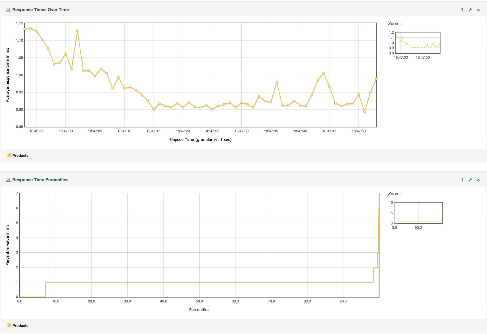
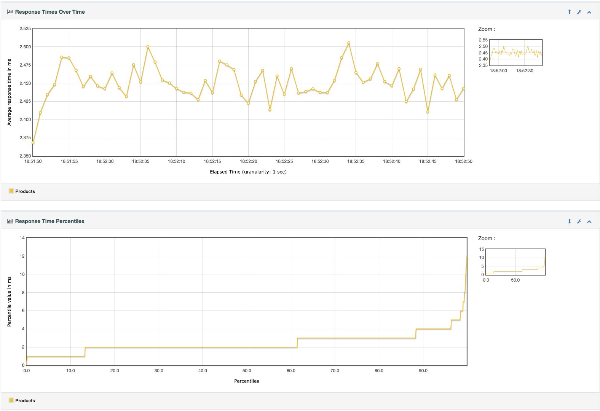
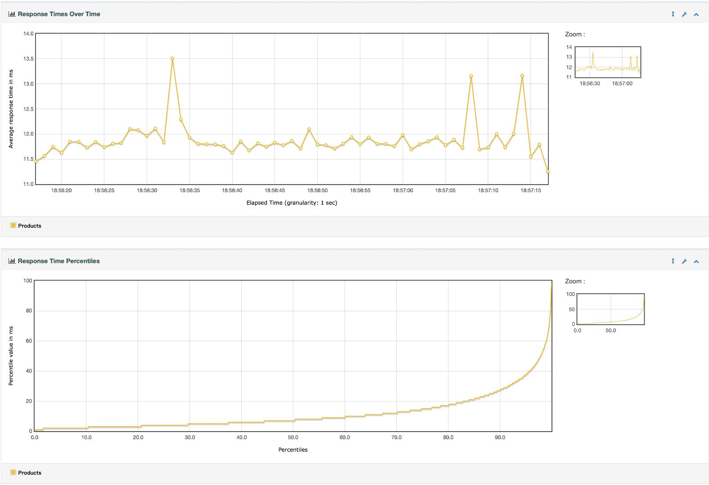
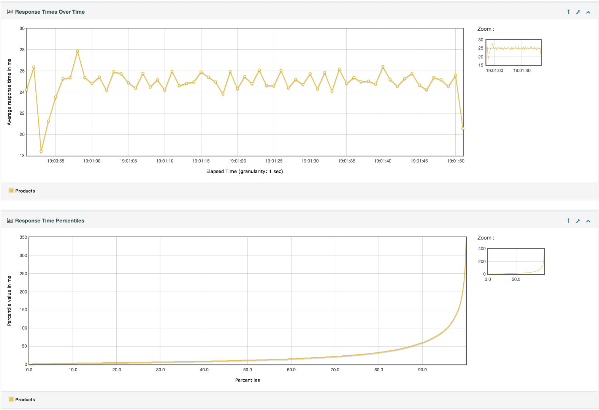
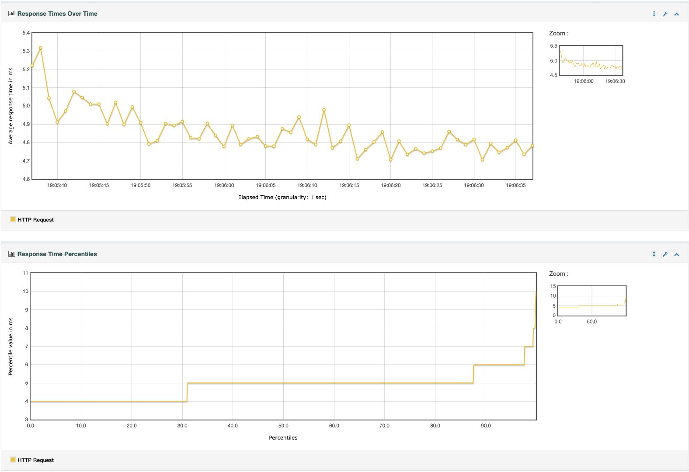
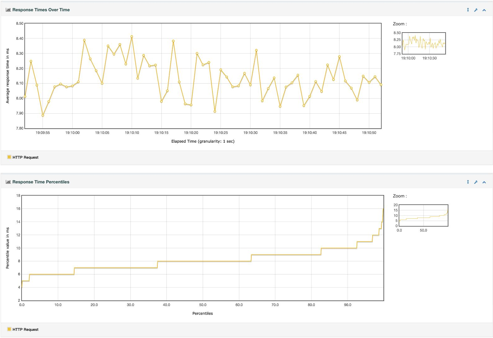
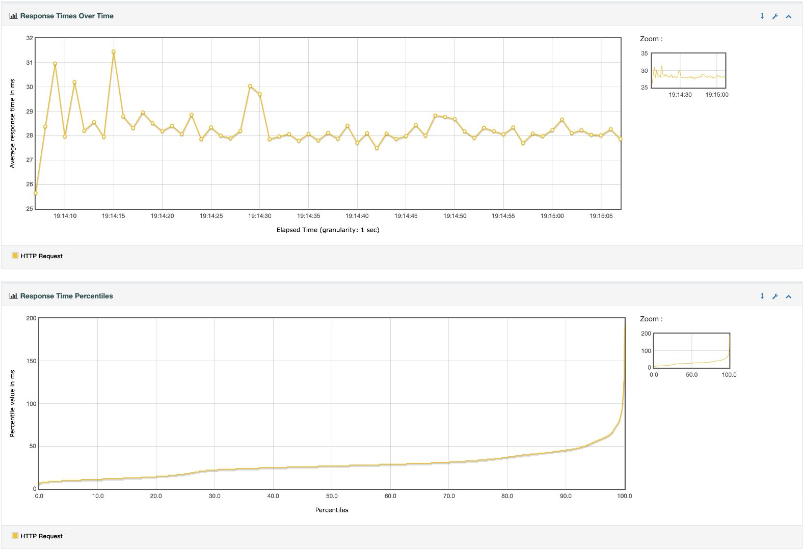
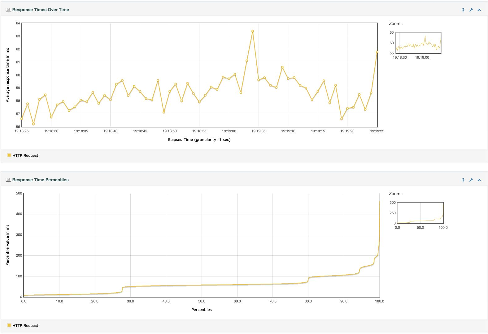

# 基于 MySQL 的 Spring 应用读写性能分析

实验三 · 原始测试日期：2026 年 10 月 22 日 · 报告修订：2026 年 10 月 26 日

::: abstract
**摘　要：** 为观察并发负载对数据库应用的影响，使用 JMeter 对 Spring Boot/JPA 应用的产品查询与新建接口分别进行测试。并发依次设为 1、10、50、100，每档重复三次，结合响应时间趋势、百分位分布、吞吐量及 Prometheus 监控进行分析。结果表明，查询与新建均在 50 并发附近出现吞吐量平台；增加到 100 并发后，吞吐量没有继续提高，P95 响应时间明显增加。查询整体优于新建，写入的尾部延迟更突出。实验说明，在本次小规格主机及固定配置下，继续增加线程主要增加等待时间，不能据此确定系统的精确容量上限。

**关键词：** MySQL；Spring Data JPA；JMeter；并发测试；响应时间百分位
:::

Read and Write Performance of a MySQL-Based Spring Application

::: english-abstract
**Abstract:** JMeter was used to evaluate product read and create APIs implemented with Spring Boot and Spring Data JPA. Concurrency increased from 1 to 10, 50 and 100 threads, with three independent runs per level. Response-time trends, percentile distributions, throughput and Prometheus metrics were analyzed. Both APIs reached a throughput plateau near 50 threads. Increasing concurrency to 100 threads raised P95 latency without improving throughput. Reads were faster than creates, while writes showed higher tail latency. The results characterize this deployment and do not establish an exact system-wide capacity limit.

**Key words:** MySQL; Spring Data JPA; JMeter; concurrency testing; response time percentiles
:::

## 1　问题描述

本实验关注两个问题：查询和新建接口在并发逐级增加时如何变化，以及吞吐量增长何时开始放缓。测试对象为 `GET /shops/{shopId}/products/{id}` 和 `POST /shops/{shopId}/products`。前者读取产品，后者保存产品后再查询产品及关联信息，因此测量的是完整 HTTP 调用链，不能将新建耗时等同于单条 INSERT 耗时。

讲义在 JPA 与 MyBatis 的表述上不一致；课程代码的 `ProductPoMapper` 继承 `JpaRepository`，本实验据此使用 JPA。新版沿用 10 月 22 日已保存的 24 轮真实数据，重新生成图表与分析。10 月 26 日仅进行服务器只读检查和本机统计，没有重新发起远程压测。

## 2　实验分析

### 2.1　实验环境与数据

四台 Ubuntu 18.04 虚拟机均为 2 核。Compiler 用于编译和 JMeter 压测，可见内存 792 MB；Node2 运行应用，内存 792 MB；Node1 运行实验 MySQL，内存 1800 MB；Manager 运行 Prometheus，内存 1800 MB。工具版本为 JDK 21.0.2、Spring Boot 4.1.1、MySQL 9.2.0、JMeter 5.6.3、Prometheus 3.7.3。

查询循环使用课程 CSV 中的 3912 组店铺与产品 ID；查询期间实验表为 4365 条，额外记录来自前置验证。每轮正式新建前将独立实验库恢复为课程初始 3912 条，新增名称使用 UUID，避免重复。12 轮写入均核对数据库增量与该轮原始成功请求数一致。数据库原始 `oomall_demo` 保持 3912 条。

### 2.2　实验方法与指标

两个接口分开测试，每个接口按 1、10、50、100 个并发线程依次运行。每档先预热 10 秒，然后进行三次独立测试。每次运行 65 秒，前 5 秒为升压段，依据 JTL 时间戳筛选后续 60 秒作为测量窗口。测量吞吐量为该窗口请求数除以 60 秒。线程数代表负载机用户线程数；增加循环次数延长请求序列，不能直接等同于增加并发。逐档同时核对 JTL 的 allThreads，区分设置线程数、实际活动线程数与正在服务端执行的请求数。少量窗口边缘样本的线程数较低，因此补充报告记录满线程数的样本比例；该比例不是按时间加权的并发率。

本文采用持续 60 秒测量的闭环线程模型，不采用参考 DOCX 中 10 秒升压、循环 2 次的短批次模型。两种模型的设置线程数不能直接比较，参考文档的数千线程及边界结论不迁移到本次环境。

JMeter 同时断言 HTTP 状态码、业务码和产品 ID。查询期望 HTTP 200、errno=0；新建期望 HTTP 201、errno=1。响应时间为客户端记录的 elapsed，包含服务端处理和网络开销；剔除升压段不等于消除 TCP/IP 影响。JTL 为毫秒精度，单次记录可能为 0 ms。

Response Times Over Time 展示每秒样本的平均响应时间，用于观察波动；Response Time Percentiles 展示不同百分位的耗时，用于识别尾部延迟。P95 表示该轮至少 95% 的样本不高于对应值。正文各档截图固定选第 1 轮，避免事后挑选；汇总数值使用三轮结果。图表由测量窗口 JTL 生成，JMeter 百分位窗口设为 100 万条，覆盖单轮样本。

为与样例对照，补充统计 40 ms 内完成的请求比例。**40 ms 是描述性参考线，不作为通用 SLA，也不据此推断精确容量临界点。** 三轮 P95 和合格比例分别取算术平均，没有将其误写为合并样本后的百分位。

### 2.3　固定配置与监控

JMeter 堆为 64～256 MB，线程栈为 512 KB；应用堆为 64～256 MB，数据库连接池为 20，Tomcat 最多 100 个工作线程，关闭逐条 SQL 输出。所有并发档保持配置一致。Prometheus 每 5 秒采集 JVM 活跃线程数及四个节点的 CPU、内存；CPU 使用 1 分钟速率窗口。原始监控 JSON 与完整部署命令保存在随附材料，正文集中展示读写加压结果。

::: stage
### 2.4　实验结果与分析

下面按两个接口分别展示逐级加压过程。每个图上半部分为响应时间趋势，下半部分为响应时间百分位；图像直接截自 JMeter HTML 报告，仅裁去导航区域并上下拼接，没有改动曲线或坐标。

### 2.4.1　查询接口逐级加压

#### 查询阶段：1 并发线程

低并发下每秒平均响应时间约为 1 ms，曲线较平稳。该阶段主要用于建立读请求基线。

第 1 轮活动线程峰值为 1，100.00% 的样本记录了设置的 1 个活动线程。测量样本为 58159 次，错误 0 次，平均耗时 0.96 ms，P95 为 1 ms，P99 为 2 ms；40 ms 内完成比例为 100.00%。三轮平均吞吐量为 **988.27 ± 16.69 次/秒**，平均 P95 为 1.00 ms，40 ms 内完成比例的三轮均值为 100.00%。

图像对应 `ReadProduct-t1-r1.jtl` 的测量窗口。完整原始 65 秒记录仍保留，不能用剔除升压后的样本数核对数据库增量。
:::

::: stage
#### 查询阶段：10 并发线程

增加到 10 并发后吞吐量明显提高，每秒平均耗时仍处于较低水平。百分位曲线大部分贴近低延迟区域。

第 1 轮活动线程峰值为 10，99.96% 的样本记录了设置的 10 个活动线程。测量样本为 234955 次，错误 0 次，平均耗时 2.45 ms，P95 为 4 ms，P99 为 6 ms；40 ms 内完成比例为 100.00%。三轮平均吞吐量为 **3884.49 ± 46.64 次/秒**，平均 P95 为 4.00 ms，40 ms 内完成比例的三轮均值为 100.00%。

图像对应 `ReadProduct-t10-r1.jtl` 的测量窗口。完整原始 65 秒记录仍保留，不能用剔除升压后的样本数核对数据库增量。
:::

::: stage
#### 查询阶段：50 并发线程

50 并发达到本次读请求最高的平均吞吐量，趋势图开始出现尖峰，百分位曲线尾部向上弯曲，说明少数请求等待时间增加。

第 1 轮活动线程峰值为 50，99.84% 的样本记录了设置的 50 个活动线程。测量样本为 249299 次，错误 0 次，平均耗时 11.89 ms，P95 为 38 ms，P99 为 61 ms；40 ms 内完成比例为 95.84%。三轮平均吞吐量为 **4190.23 ± 32.30 次/秒**，平均 P95 为 37.00 ms，40 ms 内完成比例的三轮均值为 96.09%。

图像对应 `ReadProduct-t50-r1.jtl` 的测量窗口。完整原始 65 秒记录仍保留，不能用剔除升压后的样本数核对数据库增量。
:::

::: stage
#### 查询阶段：100 并发线程

增加到 100 并发后，吞吐量较 50 并发略降，平均延迟与 P95 明显上升。曲线整体抬高，尾部增长更明显，继续加线程没有获得对应的吞吐收益。

第 1 轮活动线程峰值为 100，99.76% 的样本记录了设置的 100 个活动线程。测量样本为 235092 次，错误 0 次，平均耗时 24.95 ms，P95 为 94 ms，P99 为 190 ms；40 ms 内完成比例为 83.82%。三轮平均吞吐量为 **3969.94 ± 49.72 次/秒**，平均 P95 为 92.67 ms，40 ms 内完成比例的三轮均值为 84.19%。

图像对应 `ReadProduct-t100-r1.jtl` 的测量窗口。完整原始 65 秒记录仍保留，不能用剔除升压后的样本数核对数据库增量。
:::

::: stage
### 2.4.2　新建接口逐级加压

#### 新建阶段：1 并发线程

单并发新建的耗时高于查询基线。新建涉及数据库写入及随后读取，本次数据能够说明接口成本差异，不能把差异全部归于磁盘或锁。

第 1 轮活动线程峰值为 1，100.00% 的样本记录了设置的 1 个活动线程。测量样本为 12056 次，错误 0 次，平均耗时 4.85 ms，P95 为 6 ms，P99 为 7 ms；40 ms 内完成比例为 99.99%。三轮平均吞吐量为 **205.06 ± 3.95 次/秒**，平均 P95 为 6.00 ms，40 ms 内完成比例的三轮均值为 99.99%。

图像对应 `WriteProduct-t1-r1.jtl` 的测量窗口。完整原始 65 秒记录仍保留，不能用剔除升压后的样本数核对数据库增量。
:::

::: stage
#### 新建阶段：10 并发线程

10 并发使写入吞吐量明显提高，平均耗时仍低于 10 ms。趋势图有小幅波动，百分位曲线尚未出现高并发时的大幅抬升。

第 1 轮活动线程峰值为 10，99.97% 的样本记录了设置的 10 个活动线程。测量样本为 72825 次，错误 0 次，平均耗时 8.13 ms，P95 为 11 ms，P99 为 13 ms；40 ms 内完成比例为 100.00%。三轮平均吞吐量为 **1241.44 ± 24.29 次/秒**，平均 P95 为 10.67 ms，40 ms 内完成比例的三轮均值为 100.00%。

图像对应 `WriteProduct-t10-r1.jtl` 的测量窗口。完整原始 65 秒记录仍保留，不能用剔除升压后的样本数核对数据库增量。
:::

::: stage
#### 新建阶段：50 并发线程

50 并发达到本次新建接口最高的平均吞吐量。与 10 并发相比，P95 增加，约六分之一请求超过 40 ms，表明等待开始影响尾部响应。

第 1 轮活动线程峰值为 50，99.94% 的样本记录了设置的 50 个活动线程。测量样本为 105322 次，错误 0 次，平均耗时 28.34 ms，P95 为 56 ms，P99 为 78 ms；40 ms 内完成比例为 83.83%。三轮平均吞吐量为 **1747.01 ± 8.71 次/秒**，平均 P95 为 56.00 ms，40 ms 内完成比例的三轮均值为 83.52%。

图像对应 `WriteProduct-t50-r1.jtl` 的测量窗口。完整原始 65 秒记录仍保留，不能用剔除升压后的样本数核对数据库增量。
:::

::: stage
#### 新建阶段：100 并发线程

100 并发的平均吞吐量没有超过 50 并发，P95 则继续增加。百分位曲线明显上移，只有约四分之一请求在 40 ms 内完成，增加并发主要带来排队与延迟。

第 1 轮活动线程峰值为 100，99.81% 的样本记录了设置的 100 个活动线程。测量样本为 102105 次，错误 0 次，平均耗时 58.63 ms，P95 为 143 ms，P99 为 194 ms；40 ms 内完成比例为 27.69%。三轮平均吞吐量为 **1704.32 ± 25.60 次/秒**，平均 P95 为 143.67 ms，40 ms 内完成比例的三轮均值为 27.97%。

图像对应 `WriteProduct-t100-r1.jtl` 的测量窗口。完整原始 65 秒记录仍保留，不能用剔除升压后的样本数核对数据库增量。
:::

::: final-section
### 2.5　读写结果对比

表 1 汇总三轮结果。吞吐量给出均值与样本标准差；平均延迟、P95 和 40 ms 内比例分别为三轮指标的算术平均值。

| 接口 | 并发 | 吞吐量（次/秒） | 均值（ms） | P95（ms） | ≤40 ms（%） |
|---|---:|---:|---:|---:|---:|
| 查询 | 1 | 988.27 ± 16.69 | 0.92 | 1.00 | 100.00 |
| 查询 | 10 | 3884.49 ± 46.64 | 2.46 | 4.00 | 100.00 |
| 查询 | 50 | 4190.23 ± 32.30 | 11.79 | 37.00 | 96.09 |
| 查询 | 100 | 3969.94 ± 49.72 | 24.40 | 92.67 | 84.19 |
| 新建 | 1 | 205.06 ± 3.95 | 4.75 | 6.00 | 99.99 |
| 新建 | 10 | 1241.44 ± 24.29 | 7.95 | 10.67 | 100.00 |
| 新建 | 50 | 1747.01 ± 8.71 | 28.49 | 56.00 | 83.52 |
| 新建 | 100 | 1704.32 ± 25.60 | 58.55 | 143.67 | 27.97 |

50 并发时查询约为 4190 次/秒，新建约为 1747 次/秒。到 100 并发，查询与新建分别约为 3970、1704 次/秒，P95 则分别升至 92.67、143.67 ms。本次测试中，50 并发比 100 并发更适合兼顾吞吐和延迟；100 并发仍能成功完成请求，不能把延迟增长表述为服务崩溃。

100 并发查询时，应用 CPU 按轮均值约为 60%～64%，数据库约为 47%～52%；新建时数据库 CPU 均值约为 67%～75%，应用约为 57%～64%。应用活跃线程约为 111～115。连接池、线程调度、CPU、缓存与网络均可能影响结果，现有证据不足以认定某一个组件是唯一瓶颈。

## 3　结论与复现

在相同部署和固定参数下，查询的吞吐量高于新建；两组测试均在并发从 50 增加到 100 时出现吞吐不再增长、尾部延迟继续上升的现象。**结论限于本次 1、10、50、100 四个并发档**，尚未在 50～100 之间细化测试，因此不报告精确最大并发值。没有主动限速的 JMeter 线程组属于闭环负载：响应变慢会降低请求发出速率，不能将测得吞吐量当作任意到达率下的承载能力。

24 轮正式原始请求共 3400532 次，测量窗口内为 3227538 次，错误数均为 0。程序、JMX、完整 JTL 无损压缩文件、逐轮统计及监控数据见 [实验仓库](https://github.com/Baakarshan/mysql-read-write-lab3)。`manifest.jsonl` 对应每轮测试及数据库行数，`SHA256SUMS.txt` 用于核对原始 JTL。当前图表使用每档第 1 轮，三轮完整数值见 `results/per-run.csv`。

复现时先执行 `python3 scripts/restore-jtl.py` 和 `python3 scripts/analyze.py`，再按本次随附[复现说明](复现说明.md)重新计算曲线和生成 HTML。10 月 26 日发现其他课程服务已占用原数据库及监控主机，故此次仅在本机重做报告与统计，未恢复旧数据库或重新压测，不改动这些服务。

## 参考资料

[1] 课程实验指导：《实验三：MySQL读写性能测试》；《实验报告样例》；《软件学报排版样例2021年版》。后两项仅作结构与版式参考。

[2] 课程代码：spring-fundamentals，基线提交 e327d76，productdemoaop 模块。https://gitee.com/mingqcn/spring-fundamentals

[3] Apache JMeter User's Manual: Generating Dashboard Report. https://jmeter.apache.org/usermanual/generating-dashboard.html

[4] Prometheus documentation: Querying basics. https://prometheus.io/docs/prometheus/latest/querying/basics/
:::
