# 实验三：MySQL 读写性能测试

实验日期：2026 年 10 月 22 日。程序、测试计划和原始数据：[GitHub 仓库](https://github.com/Baakarshan/mysql-read-write-lab3)。详细操作命令见[复现说明](复现说明.md)。

## 1. 实验目标与设计

使用 Spring Boot REST 接口读写 MySQL，观察并发增加后吞吐量和响应时间的变化，同时记录应用线程数、节点 CPU 和内存。查询接口为 `GET /shops/{shopId}/products/{id}`，新建接口为 `POST /shops/{shopId}/products`。

**本次使用 Spring Data JPA。** 讲义的实验目的写 JPA，实验内容写 MyBatis；实际课程代码 `ProductPoMapper` 继承 `JpaRepository`，因此本报告测量 JPA 应用的读写表现，不作 JPA 与 MyBatis 的性能比较。

查询经过 Controller、Service、Dao 后调用 `findById`。新建先调用 `save` 插入产品，再读取产品及关联信息后返回。**新建接口包含插入后的查询，测得的时间是整个 HTTP 接口耗时**，不能解释成单条 INSERT 的数据库耗时。

每个接口测试 1、10、50、100 个并发线程，每档先预热 10 秒，再独立运行三次。每次原始运行 65 秒，前 5 秒用于升压，统计时从最早采样时间加 5 秒起筛选 60 秒窗口。两个接口依次测试，避免互相争用资源。

查询循环读取课程 `products.csv` 中的 3912 组店铺、产品 ID；新建使用唯一的 `lab3-UUID` 名称，其他字段固定。JMeter 同时检查 HTTP 状态、业务码 `errno` 和返回产品 ID。查询期望 200/0，新建期望 201/1。

## 2. 环境与准备

四台机器均为 Ubuntu 18.04、2 核；Compiler 和 Node2 系统可见内存为 792 MB，Node1 和 Manager 为 1800 MB。编译使用 JDK 21.0.2、Maven 3.9.16；JMeter 5.6.3；MySQL 9.2.0；Prometheus 3.7.3。构建与压测命令均显式设置 `JAVA_HOME` 为 JDK 21。

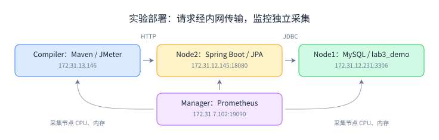

Compiler 负责编译和压测，Node2 运行本次应用，Node1 复用现有 MySQL 容器中的独立 `lab3_demo`，Manager 运行独立 Prometheus。原有 `oomall_demo` 数据库和 `lab_productdemojpa` 服务保留，数据传输使用内网。

环境检查输入 `hostname`、`free -m`、`nproc` 和版本命令，确认资源后配置内存。原始检查记录见 `logs/01-environment.txt`。

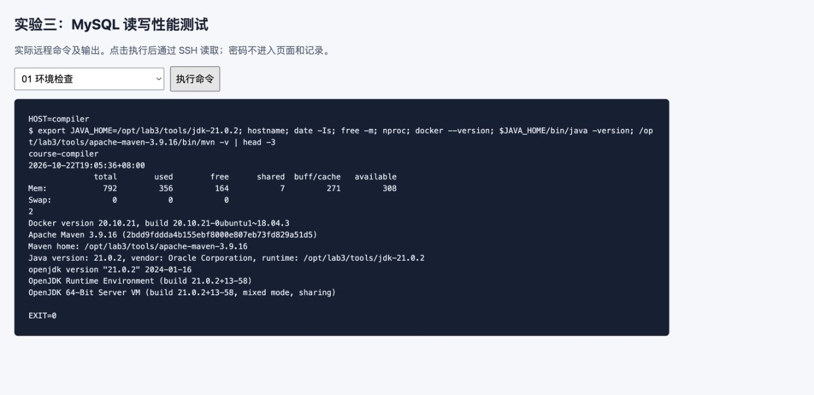

讲义示例的 JMeter 堆为 2～4 GB，本机内存不足。默认 1 GB 堆也出现启动失败，因此改成 `-Xms64m -Xmx256m -Xss512k -XX:MaxMetaspaceSize=128m`。应用使用 64～256 MB 堆、20 个数据库连接、最多 100 个 Tomcat 工作线程，所有测试保持同一配置。应用关闭 SQL 逐条输出，业务日志为 INFO。

## 3. 部署与接口验证

课程代码来自机器上已有的 [spring-fundamentals](https://gitee.com/mingqcn/spring-fundamentals)，基线提交为 `e327d76`，模块为 `5. SpringAOP/productdemoaop`。保留业务 Java 代码，修改连接配置、运行参数和日志配置；`clonefactory` 固定编译插件版本，并去掉无版本且无实际用途的 Boot 打包插件。完整变更见 `source/` 与 `scripts/`。

按依赖顺序先安装 `clonefactory`，再安装 `core`，最后用 `pre-integration-test` 构建应用和镜像。输出均为 `BUILD SUCCESS`，生成镜像 `xmu-javaee/productdemoaop:0.0.1-SNAPSHOT`。完整日志位于 `logs/03-build-*.log`。

```bash
cd clonefactory
mvn install -Dmaven.test.skip=true
cd '../5. SpringAOP'
mvn install -pl core -am -Dmaven.test.skip=true
mvn pre-integration-test -pl productdemoaop -Dmaven.test.skip=true
```

以上为步骤摘要；实际命令使用华为云 Maven 镜像和 256 MB Maven 堆，见 `scripts/build.sh`。

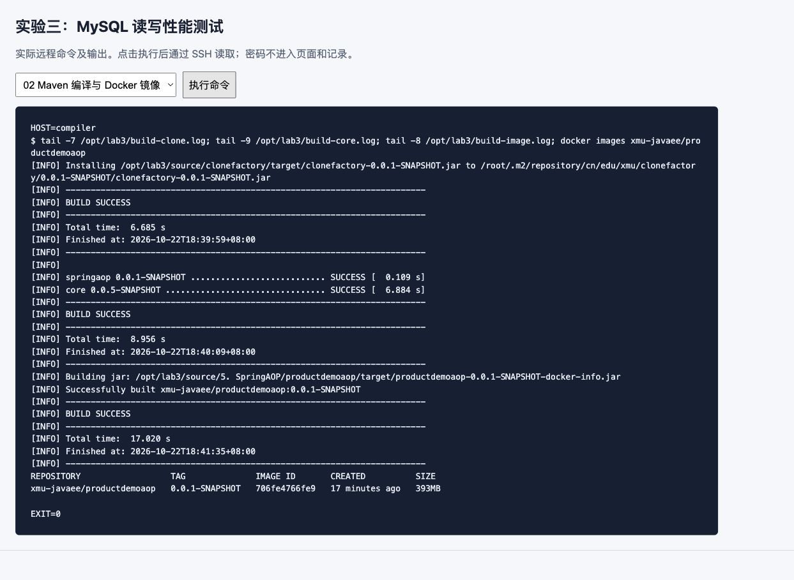

新建 `lab3_demo` 后导入课程 `product.sql`，初始产品数为 3912。手工验证新增 1 条，JMeter 写入试跑新增 452 条，故正式查询期间总表为 4365 条；查询数据集仍只取课程原有 3912 个产品。**正式写入每轮都恢复到 3912 条，再检查数据库增量等于该轮原始成功请求数。** 原有 `oomall_demo` 始终保持 3912 条。

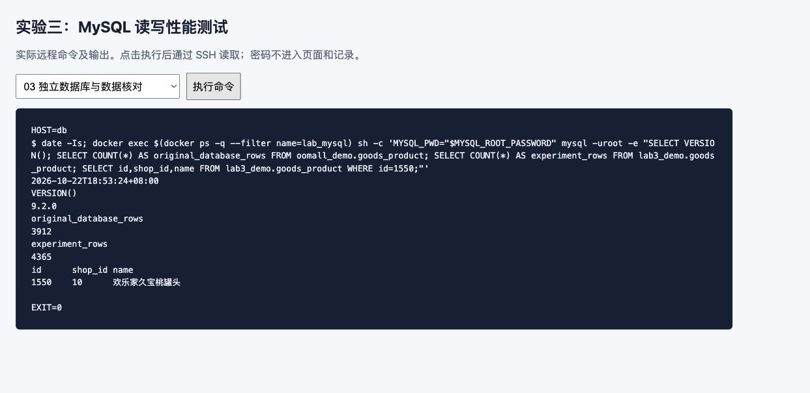

镜像通过内网传到 Node2，应用容器为 `lab3-productdemoaop`，绑定 `172.31.12.145:18080`。`/actuator/health` 返回 HTTP 200 和 `UP`，已有服务继续运行。

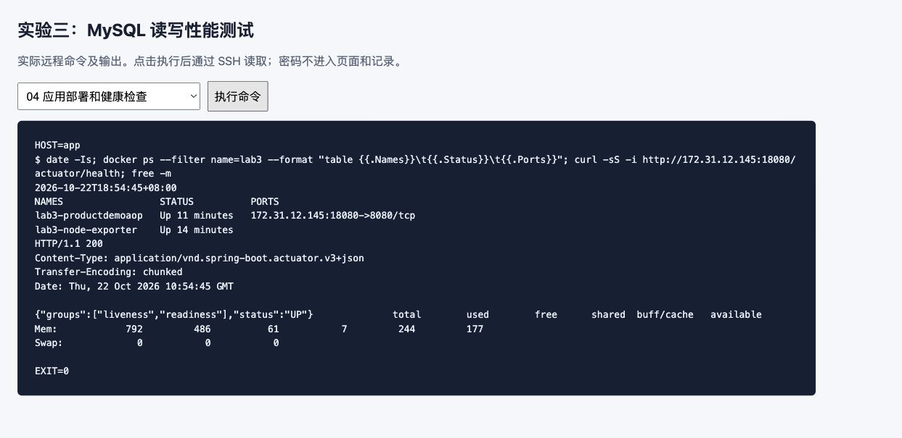

查询输入为 `curl -i http://172.31.12.145:18080/shops/10/products/1550`，返回 HTTP 200、`errno=0`，产品 ID 为 1550，店铺 ID 为 10。

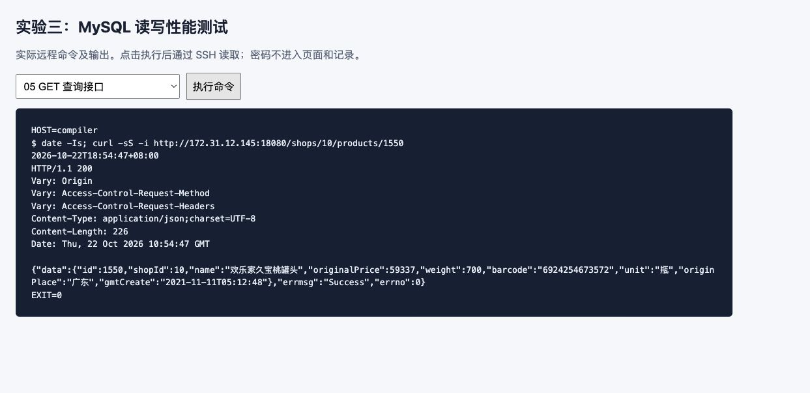

新建请求使用 JSON 请求体，填写名称、原价、重量等字段，并按课程切面约定提供模拟管理员 `Authorization` JSON。它是课程演示身份，不是实际账号令牌。返回 HTTP 201、`errno=1` 和新产品 ID；再查询该 ID 验证落库。下图为正式压测完成后再次执行的新建及回查验证，不计入压测统计。

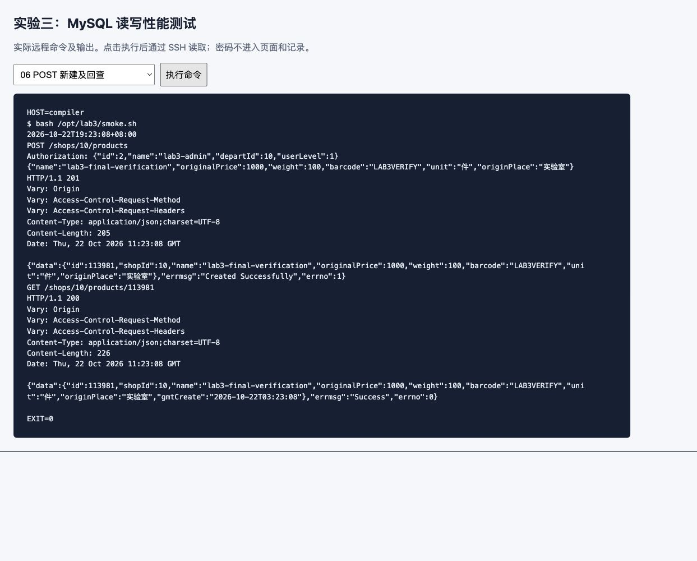

## 4. 监控与正式压测

四台机器各运行一个 node-exporter，Prometheus 另采集应用 `/actuator/prometheus`。在 Target health 检查节点 4/4 UP、应用 1/1 UP，在 Rule health 检查三条规则均为 OK。

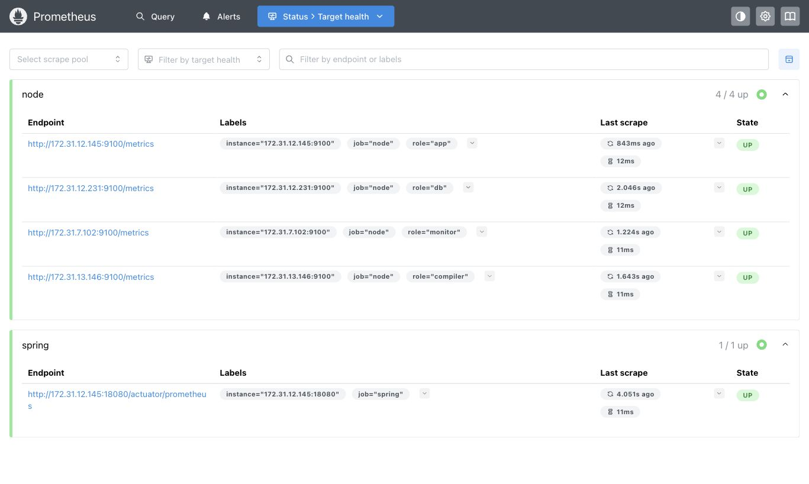

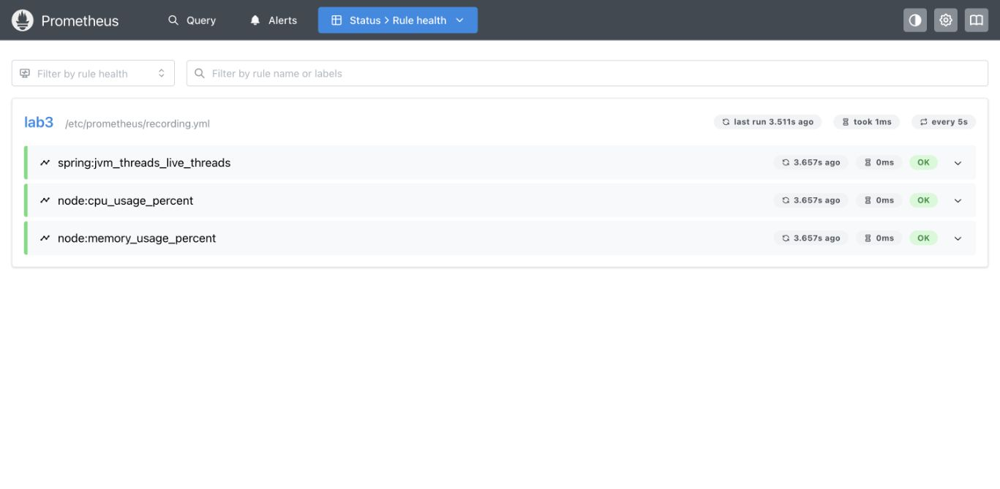

使用 `spring:jvm_threads_live_threads`、`node:cpu_usage_percent`、`node:memory_usage_percent` 三个查询。CPU 由各核空闲时间速率计算；内存按 `100 × (1 - MemAvailable / MemTotal)` 计算。监控采样和规则求值间隔均为 5 秒，CPU 使用 1 分钟速率窗口。

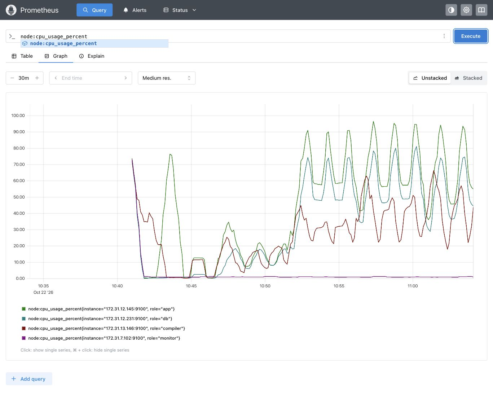

JMeter 以非 GUI 模式运行，结果写入独立 JTL。以下为一轮 10 并发查询示例，正式脚本会自动预热、重复并保存原始日志：

```bash
jmeter -n -t ReadProduct.jmx -q user.properties \
  -Jthreads=10 -Jramp=5 -Jduration=65 \
  -l ReadProduct-t10-r1.jtl -j ReadProduct-t10-r1.log
```

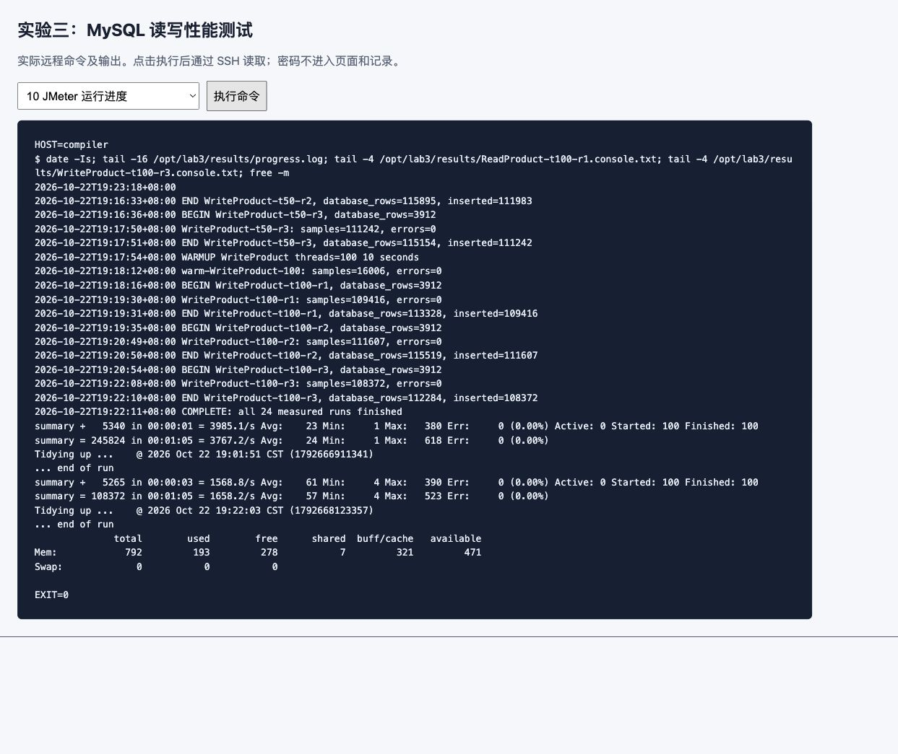

## 5. 测试结果

**24 轮正式测试共保留 3400532 次原始请求，其中测量窗口内 3227538 次，错误数均为 0。**

| 接口 | 并发 | 吞吐量均值 ± 标准差（次/秒） | 平均延迟（ms） | P95 均值（ms） | 错误数 |
|---|---:|---:|---:|---:|---:|
| 查询 GET | 1 | 988.27 ± 16.69 | 0.92 | 1.00 | 0 |
| 查询 GET | 10 | 3884.49 ± 46.64 | 2.46 | 4.00 | 0 |
| 查询 GET | 50 | 4190.23 ± 32.30 | 11.79 | 37.00 | 0 |
| 查询 GET | 100 | 3969.94 ± 49.72 | 24.40 | 92.67 | 0 |
| 新建 POST | 1 | 205.06 ± 3.95 | 4.75 | 6.00 | 0 |
| 新建 POST | 10 | 1241.44 ± 24.29 | 7.95 | 10.67 | 0 |
| 新建 POST | 50 | 1747.01 ± 8.71 | 28.49 | 56.00 | 0 |
| 新建 POST | 100 | 1704.32 ± 25.60 | 58.55 | 143.67 | 0 |

吞吐量为测量窗口内的请求数除以 60 秒。表中吞吐量、平均延迟和 P95 均为三轮对应指标的算术平均值；吞吐量标准差反映三轮波动，**P95 的均值不是三轮合并后的 P95**。逐轮值见 `results/per-run.csv`，原始时间戳和耗时见 `data/*.jtl.gz`。

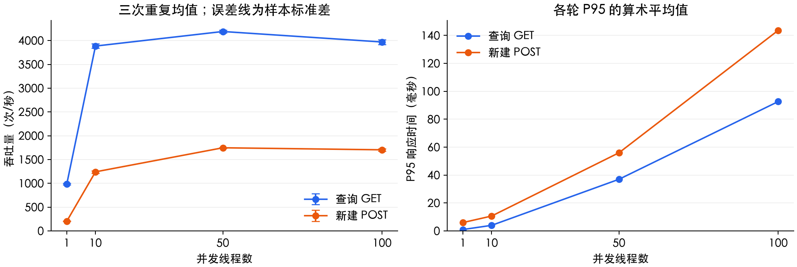

查询吞吐量从 1 并发的 988.27 次/秒增加到 50 并发的 4190.23 次/秒，100 并发时为 3969.94 次/秒，P95 同时从 37 ms 上升到 92.67 ms。新建在 50 并发后也接近平台期，继续加线程主要增加等待时间。**本次环境中，50 并发比 100 并发更适合兼顾吞吐量与延迟**；这只是四台小规格主机、当前配置与数据集的结果。

查询会受到应用、数据库和文件缓存影响，新建还包含插入后的查询。连接池固定为 20，应用与压测机资源也有限；因此只能判断整条 HTTP 调用链随并发增加出现了排队，不能据此认定 MySQL 是唯一瓶颈。

JMeter HTML 报告选取查询、新建各一轮 100 并发记录，由去掉升压阶段的测量 JTL 生成；生成时将百分位统计窗口设为 100 万条，覆盖该轮全部样本。原始 65 秒记录另行保留，不用截图中的四舍五入结果代替原始数据。

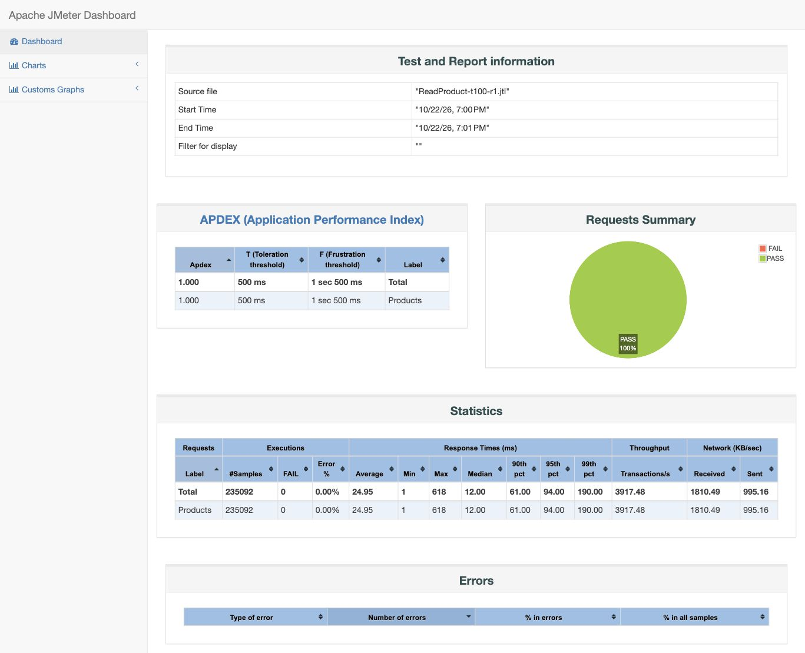


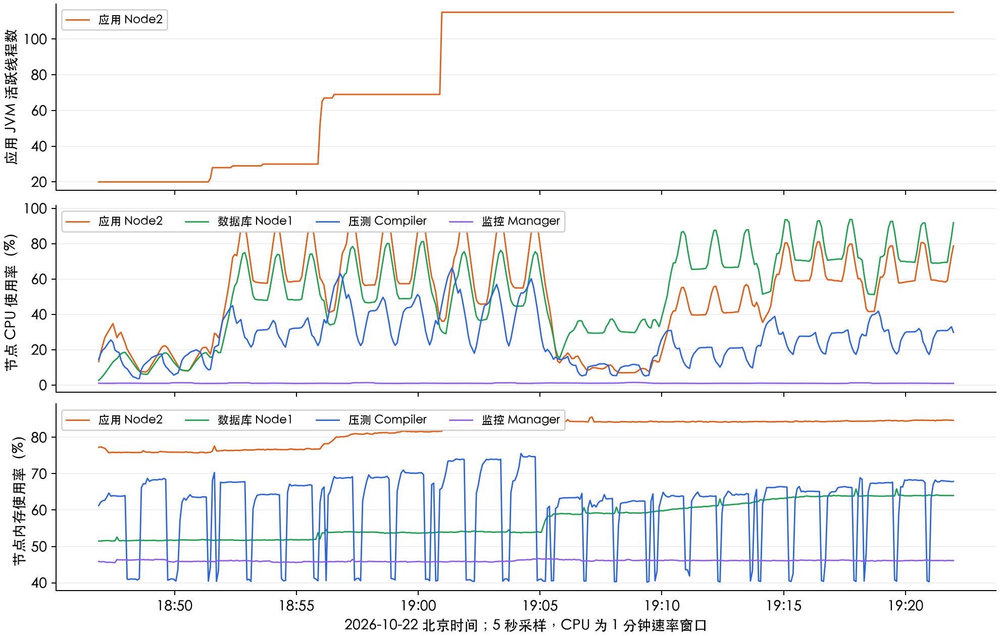

100 并发时应用 JVM 活跃线程约为 111～115；三轮查询的应用 CPU 均值约为 60%～64%，数据库约为 47%～52%。100 并发新建时数据库 CPU 均值约为 67%～75%，应用约为 57%～64%。Node2 内存占用约为 83%～85%，资源余量有限；监控机 CPU 约为 1%。这些值见 `results/monitoring/per-run.csv`。

CPU 曲线使用 1 分钟速率窗口，会平滑相邻轮次；整段曲线也包含间隔、预热和实验库恢复。上述按轮均值仅取正式测量窗口的 5 秒采样点，不等同于逐请求测量。

## 6. 记录与复现

12 轮正式写入全部满足 `数据库后值 - 前值 = 原始成功 POST 数`。最后一轮从 3912 条增加到 112284 条；压测后截图验证又新增 1 条，ID 为 113981，最终实验库为 **112285 条**。再次核对原有 `oomall_demo.goods_product` 仍为 **3912 条**，记录见 `logs/10-final-database.txt`。

交付的 `data/manifest.jsonl` 记录每轮请求数和数据库前后行数；`data/SHA256SUMS.txt` 校验原始 JTL；`logs/` 保存环境、构建和接口操作输出；`results/monitoring/` 保存三项 PromQL 的原始 JSON。命令截图由本机的 SSH 输出记录页面实际执行并截取，监控与 HTML 报告直接截取浏览器页面。

重新验证数据只需克隆仓库，执行 `python3 scripts/restore-jtl.py` 和 `python3 scripts/analyze.py`。重新部署或压测按[复现说明](复现说明.md)操作；其中写入只针对本次独立实验库。
